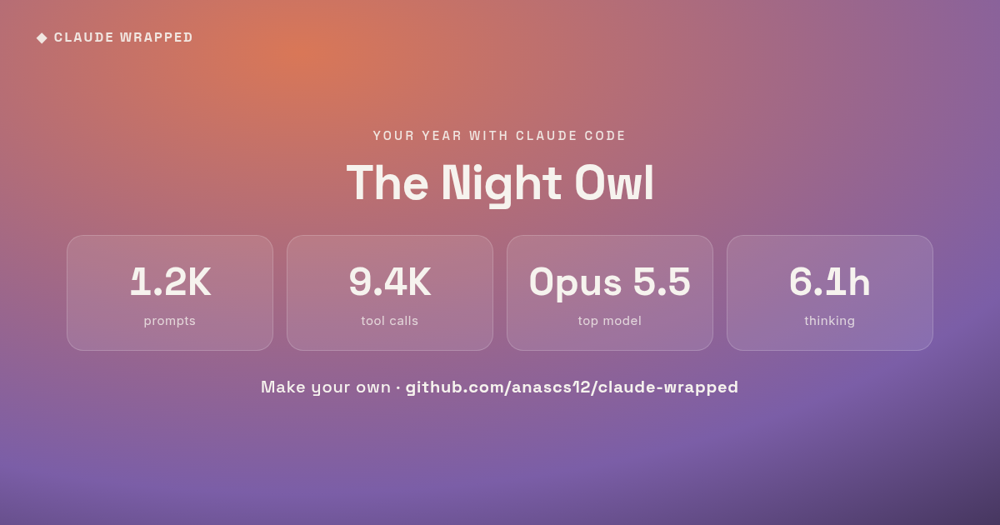

# Claude Wrapped

Your year with Claude Code, as a Spotify-Wrapped-style page you can screenshot and share.

It reads the session logs Claude Code already keeps on your machine
(`~/.claude/projects`) and turns them into a scrollable set of bold cards: your
biggest numbers, a fun persona, when you work, your top tools, and your top
projects.

**Everything runs locally. Nothing is uploaded.** The only network request is a
Google Fonts link in the generated page, loaded when you open it in your browser.



## Quick start (no install)

```bash
git clone https://github.com/<you>/claude-wrapped
python3 claude-wrapped/skills/claude-wrapped/scripts/wrapped.py --open
```

That writes `claude-wrapped.html` and opens it. Scroll through, then screenshot
the final summary card to share.

Needs only Python 3.8+ — standard library, no `pip install`.

## Use it as a Claude Code skill

Drop the skill where Claude Code looks for personal skills:

```bash
cp -r claude-wrapped/skills/claude-wrapped ~/.claude/skills/
```

Then just ask Claude Code:

> show me my Claude Wrapped

## Use it as a Claude Code plugin

This repo is a plugin (`.claude-plugin/plugin.json`). Add it to a marketplace or
install it locally, and the `claude-wrapped` skill becomes available in any
session.

## What it measures

| Card | From your logs |
|------|----------------|
| Prompts & replies | user turns vs. assistant turns |
| Tool calls | every `tool_use` block, ranked |
| Tokens & words | logged output-token usage |
| When you work | local-time hour and weekday histograms |
| Thinking time | `thinkingDurationMs` across all replies |
| Top projects | prompts grouped by working directory |
| Persona | derived from your busiest hours and favourite tool |

## Options

```
python3 wrapped.py [--out FILE] [--projects DIR] [--open]
```

- `--out FILE` — where to save (default `claude-wrapped.html`)
- `--projects DIR` — override history location (default `~/.claude/projects`)
- `--open` — open in your browser when done

## Privacy

The script only reads `.jsonl` files under your projects directory and writes one
HTML file. It makes no network calls. Your prompts and code never leave your
machine; the page shows counts and timing, not the contents of your chats.

## License

MIT
